# 通信协议与标准

## 一、通信协议

### 1.SPI协议与电路

#### 1.1 理论基础

**当单片机使用SPI控制信号连接到传感器或者控制器时，串接22Ω或33Ω电阻的主要原因在于抑制反射和振铃。**


SPI (Serial Peripheral Interface, 串行外围设备接口) 是一种高速(通常为**1~70MHz**)、全双工、同步通信总线。

SPI通讯协议的优点：

1)支持全双工通信，

2)通讯方式较为简单，

3）数据传输速率较快。  

缺点：

1)没有指定的流控制，没有应答机制，在数据可靠性上有一定缺陷，

2)只支持单个主机，

3)从机不能主动传输，收发都由主机控制。

SPI只占用四根管脚(**SCLK、CS、MOSI、MISO**)来控制以及数据传输，广泛应用Flash、ADC、LCD等设备与MCU间的通信 。

 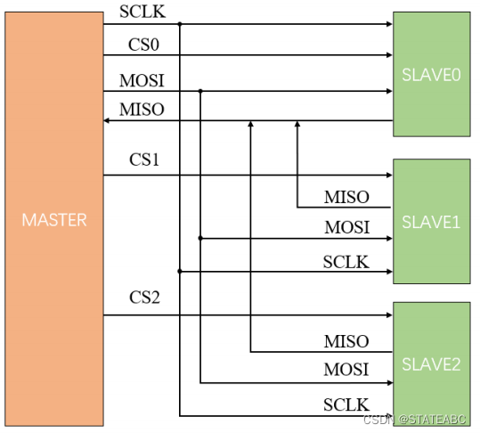 


- <mark><strong>SCLK</strong></mark>(Serial Clock):时钟信号，由主设备产生；
- <mark><strong>CS/SS</strong></mark>(Chip Select/Slave Select):从设备片选信号，由主设备控制，通常低电平有效；
- <mark><strong>MISO</strong></mark>(Master Input Slave Output):主设备数据输入，从设备数据输出；
- <mark><strong>MOSI</strong></mark>(Master Output Slave Input):主设备数据输出，从设备数据输入。

#### 1.2 SPI通信协议

SPI一共有四种通讯模式，由 **时钟极性(CPOL)和时钟相位(CPHA)** 控制总线空闲时SCLK的时钟状态以及数据采样时刻。

| SPI模式 | CPOL | CPHA | 空闲时SCLK时钟 | 采样时刻 |
| :-----: | :--: | :--: | :------------: | :------: |
|    0    |  0   |  0   |     低电平     | 奇数边沿 |
|    1    |  0   |  1   |     低电平     | 偶数边沿 |
|    2    |  1   |  0   |     高电平     | 奇数边沿 |
|    3    |  1   |  1   |     高电平     | 偶数边沿 |

时钟相位CPHA是指数据的采样的时刻，当CPHA=0时，MOSI或MISO数据线上的信号将会在SCK时钟线的“奇数边沿”被采样。当CPHA=1时， 数据线在SCK的“偶数边沿”采样。见 图 [CPHA = 0时的SPI通讯模式](#spi-cpha-0)及图  [CPHA = 1时的SPI通讯模式](#spi-cpha-1)。

##### CPHA = 0时的SPI通讯模式 {#spi-cpha-0}

 


分析该时序图可知，根据SCK在空闲状态时的电平，分两种情况。SCK信号线在空闲状态为低电平时，CPOL=0；空闲状态为高电平时，CPOL=1。

无论CPOL=0还是1，因为我们配置的时钟相位CPHA=0，在图中可以看到，采样时刻都是在SCK的奇数边沿。注意当CPOL=0时，时钟的奇数边沿是上升沿，而CPOL=1时，时钟的奇数边沿是下降沿。所以SPI的采样时刻不是由上升/下降沿决定的。MOSI和MISO数据线的有效信号在SCK的奇数沿保持不变，数据信号将在SCK奇数沿时被采样，在非采样时刻，MOSI和MISO的有效信号才发生切换。

类似的，当CPHA=1时，采样时刻为SCK的偶数边沿，如图 [CPHA = 1时的SPI通讯模式](#spi-cpha-1)。

##### CPHA = 1时的SPI通讯模式 {#spi-cpha-1}

  


SPI协议规定一个SPI设备不能在数据通信过程中仅仅充当一个发送者(Transmitter)或者接收者(Receiver)。在片选信号CS为0的情况下，每个clock周期内，SPI设备都会发送并接收1bit数据，相当于有1bit数据被交换。

SPI每次数据传输可以8位或16位为单位，每次传输的单位数不受限制。

SPI最大通信速率由主设备和从设备的硬件性能决定，通常在<mark>几百kHz到几十MHz</mark>之间。

#### 1.3 常见SPI硬件电路

  

以GD25Q127CSIG为例：

- $\overline{\text{CE}}$：片选信号，低电平触发，上拉到电源代表默认不选中任何一个从设备。
- $\overline{\text{WP}}$：写保护信号，低电平触发，上拉到电源代表默认关闭写保护，任何时候CPU都可以对它进行操作，低电   平时，写保护打开，主机不能写入数据。
- $\overline{\text{HOLD}}$：设备暂停引脚，当为低电平时，通讯暂停，数据输出引脚输出高阻态，时钟和数据输入引脚无效。


### 2.I<sup>2</sup>C协议与电路

#### 2.1理论基础

**I²C（Inter-Integrated Circuit）** 是一种由飞利浦公司（现恩智浦）设计的**同步、半双工、多主多从**串行通信协议，广泛用于连接低速外设（如传感器、EEPROM、RTC等）。其核心特点如下：

- **两根信号线**：
  - **SDA（Serial Data Line）**：双向数据线。
  - **SCL（Serial Clock Line）**：主设备控制的时钟线。
- **总线拓扑**：所有设备通过开漏输出（Open-Drain）连接到总线，需外接**上拉电阻**（Pull-Up Resistor）确保高电平。
- **通信速率**：
  - 标准模式（Standard Mode）：**100 kbps**
  - 快速模式（Fast Mode）：**400 kbps**
  - 快速模式+（Fast Mode Plus）：**1 Mbps**
  - 高速模式（High-Speed Mode）：**3.4 Mbps**

#### 2.2 I<sup>2</sup>C通信协议

##### 2.2.1 基本时序

- **起始条件（Start Condition）**：
  - SCL为高电平时，SDA从高电平跳变到低电平。
- **停止条件（Stop Condition）**：
  - SCL为高电平时，SDA从低电平跳变到高电平。
- **数据有效性**：
  - 数据在SCL高电平时必须保持稳定，仅在SCL低电平时允许变化。

##### 2.2.2 I<sup>2</sup>C基本读写过程

 

这些图表示的是主机和从机通讯时，SDA线的数据包序列。

其中S表示由主机的I2C接口产生的传输起始信号(S)，这时连接到I2C总线上的所有从机都会接收到这个信号。

起始信号产生后，所有从机就开始等待主机紧接下来广播 的从机地址信号 (SLAVE_ADDRESS)。在I2C总线上， 每个设备的地址都是唯一的，当主机广播的地址与某个设备地址相同时，这个设备就被选中了，没被选中的设备将会忽略之后的数据信号。 根据I2C协议，这个从机地址可以是7位或10位。

在地址位之后，是传输方向的选择位，该位为0时，表示后面的数据传输方向是由主机传输至从机，即主机向从机写数据。该位为1时，则相反，即主机由从机读数据。

从机接收到匹配的地址后，主机或从机会返回一个应答(ACK)或非应答(NACK)信号，只有接收到应答信号后，主机才能继续发送或接收数据。

**写数据**

若配置的方向传输位为“写数据”方向，即第一幅图的情况，广播完地址，接收到应答信号后，主机开始正式向从机传输数据(DATA)， 数据包的大小为8位，主机每发送完一个字节数据，都要等待从机的应答信号(ACK)，重复这个过程，可以向从机传输N个数据， 这个N没有大小限制。当数据传输结束时，主机向从机发送一个停止传输信号(P)，表示不再传输数据。

**读数据**

若配置的方向传输位为“读数据”方向，即第二幅图的情况，广播完地址，接收到应答信号后，从机开始向主机返回数据(DATA)， 数据包大小也为8位，从机每发送完一个数据，都会等待主机的应答信号(ACK)，重复这个过程，可以返回N个数据，这个N也没有大小限制。 当主机希望停止接收数据时，就向从机返回一个非应答信号(NACK)，则从机自动停止数据传输。

**读和写数据**

除了基本的读写，I2C通讯更常用的是复合格式，即第三幅图的情况，该传输过程有两次起始信号(S)。一般在第一次传输中， 主机通过SLAVE_ADDRESS寻找到从设备后，发送一段“数据”，这段数据通常用于表示从设备内部的寄存器或存储器地址(注意区分它与SLAVE_ADDRESS的区别)； 在第二次的传输中，对该地址的内容进行读或写。也就是说，第一次通讯是告诉从机读写地址，第二次则是读写的实际内容。 

##### 2.2.3. 数据帧格式

每次传输由以下部分组成：

1. **起始信号和停止信号**（Start）：

    当 SCL 线是高电平时 SDA 线从高电平向低电平切换，这个情况表示通讯的起始。 当 SCL 是高电平时 SDA 线由低电平向高电平切换，表示通讯的停止。起始和停止信号一般由主机产生。 

     

2. **地址帧**（7位或10位从机地址 + 1位读写标志）：

    I2C总线上的每个设备都有自己的独立地址，主机发起通讯时，通过SDA信号线发送设备地址(SLAVE_ADDRESS)来查找从机。 I2C协议规定设备地址可以是7位或10位，实际中7位的地址应用比较广泛。紧跟设备地址的一个数据位用来表示数据传输方向， 它是数据方向位(R/)，第8位或第11位。数据方向位为“1”时表示主机由从机读数据，该位为“0”时表示主机向从机写数据。 

     

    读数据方向时，主机会释放对SDA信号线的控制，由从机控制SDA信号线，主机接收信号， 写数据方向时，SDA由主机控制，从机接收信号。 

3. **应答位**（ACK/NACK）：接收方在每字节后发送：

    数据的每一字节（包括地址字节）后总是伴随着来自接收方的1位ACK位。ACK位使得接收方可以告知发送方当前字节已成功接收，并且可以发送下一字节。 在接收方发送ACK位前，发送方必须释放总线。接收方通过在ACK/NACK时钟周期（第9时钟周期） 的低电平相位拉低SDA线来发送一个ACK位，如此一来，SDA线将会在ACK/NACK时钟周期的高电平相位保持为低电平。设置与保持时间必须着重注意。 如果SDA线在ACK/NACK时钟周期保持为高电平，这将会被作为NACK。有好几种状态将会导致 NACK的产生： 

   1、接收方无法进行接收或发送，因为其正在执行一些实时性功能（real-timefunction），无法与主机进行通讯。 

   2、在发送期间，接收方收到了无法识别的数据或指令。 

   3、在发送期间，接收方无法接收更多数据字节（也就是缓冲区满了）。 

   4、作为接收方的主机完成了数据读取，因此通过发送一个NACK通知从机。 

     

4. **数据帧**（8位数据）：

    数据位伴随着SCL上的每一个时钟脉冲被传输。单个字节由SDA线上的8位数据组成，其可以是设备地址、寄存器地址或者读自/写入设备的数据。数据以<mark>大端在前（MSB）</mark>的方式传输。在START标志与 STOP标志之间可以传输<mark>任意数量</mark>的数据字节。SDA线上的数据必须在时钟电平为高时保持稳定，因为 SCL 线为高时，SDA线上的变动将会被当作控制指令（START或STOP）。 

     

#### 2.3 常见 I<sup>2</sup>C硬件电路

 EEPROM是一种掉电后数据不丢失的存储器，常用来存储一些配置信息，以便系统重新上电的时候加载之。 EEPOM芯片最常用的通讯方式就是I2C协议， 本小节以EEPROM的读写实验为大家讲解STM32的I2C使用方法。 实验中STM32的I2C外设采用主模式，分别用作主发送器和主接收器，通过查询事件的方式来确保正常通讯。 

##### 2.3.1 硬件设计

  

 本实验板中的EEPROM芯片(型号：AT24C02)的SCL及SDA引脚连接到了STM32对应的I2C引脚中，结合上拉电阻， 构成了I2C通讯总线，它们通过I2C总线交互。EEPROM芯片的设备地址一共有7位，其中高4位固定为：1010 b， 低3位则由A0/A1/A2信号线的电平决定 ，图中的R/W是读写方向位，与地址无关。 

  

按照我们此处的连接，A0/A1/A2均为0，所以EEPROM的7位设备地址是：101 0000b，即0x50。 由于I2C通讯时常常是地址跟读写方向连在一起构成一个8位数，且当R/W位为0时，表示写方向， 所以加上7位地址，其值为“0xA0”，常称该值为I2C设备的“写地址”；当R/W位为1时，表示读方向， 加上7位地址，其值为“0xA1”，常称该值为“读地址”。

EEPROM芯片中还有一个WP引脚，具有写保护功能，当该引脚电平为高时，禁止写入数据，当引脚为低电平时， 可写入数据，我们直接接地，不使用写保护功能。

##### 2.3.2 上拉电阻设计

- SDA和SCL线必须接上拉电阻（典型值：4.7kΩ~10kΩ）。

- 上拉电阻最大值

   首先我们需要明白上升沿的时间是如何来的。 I<sup>2</sup>C 的总线结构如下图，是一个漏极开路的结构。也就是说SDA/SCL由低电平变到高电平，是通过关闭MOS管，通过Rp上拉到电源。 

  

   而I2C总线上接入设备时，肯定是会引入电容的，接的设备越多，引入的电容也越多。所以输出高电 平的过程，<mark>实际上是一个RC充电的电路</mark>。 如下图，电源Vdd通过上拉电阻Rp对负载电容Cb充电的过程。 

  

   电平有0.1V<sub>DD</sub>充到0.9V<sub>DD</sub>（上升沿）的时间计算公式:
  $$
  T_r=R_p*C_b*ln\frac{V_{DD}−0.1*V_{DD}}{V_{DD}−0.9*V_{DD}}=2.2*R_p*C_b
  $$
  标准模式：由T<sub>r</sub>&lt;1000ns 得 R&lt;1000ns/2.2C 

  快速模式：由T<sub>r</sub>&lt;300ns 得 R&lt;300ns/2.2C =2.2C

   不同电路，C的值肯定是不同的，所以要根据实测信号上升沿来确定。 

   <mark>注意</mark>：协议中最大电阻与负载电容的曲线，对应T<sub>r</sub>是很宽松的，应是取的T<sub>r</sub>为0.3V<sub>DD</sub>上升到 0.7V<sub>DD</sub> 的时间（协议中低电平门限0.3V<sub>DD</sub>，高电平门限0.7V<sub>DD</sub>），可能与上述公式有些出入，上述公式取的是0.1V<sub>DD</sub>上升到0.9V<sub>DD</sub>。 

- 上拉电阻最小值

  计算公式：

  
  $$
  R_{min}=\frac{V_{DD}−V_{OL}}{I_{OL}}
  $$
  

  其中：

  - **V<sub>DD</sub>**：电源电压（如3.3V或5V）。
  - **V<sub>OL</sub>**：输出低电平电压（通常≤0.4V）。
  - **I<sub>OL</sub>**：驱动电流（参考器件手册）。

<mark>综上所述，如果我们发现I2C的上升沿过缓，可以通过减小上拉电阻Rp来实现，但不应小于对应的 Rmin；或者降低总线电容（减少总线上的设备数量）；最后还可以通过增加器件来实现（详见I2C标准协议第41页）</mark>

##### 2.3.3 I<sup>2</sup>C串联保护电阻设计

 I<sup>2</sup>C协议还定义了串联在SDA、SCL线上电阻R<sub>S</sub>。该电阻的作用是，有效抑制总线上的干扰脉冲进入从设备， 提高可靠性，这个电阻的选择一般在100～200ohm左右。 


### 3. CAN 总线协议与电路 {#can-bus}

#### 3.1 概述：CAN 解决什么问题 {#can-overview}

CAN（Controller Area Network，控制器局域网）适合把多个控制器连接起来，交换转速、温度、状态和控制指令等短消息。它支持**多主、广播、按优先级仲裁**：每个节点都可以申请发送，其他节点同时接收，再决定是否把报文交给应用程序。

本节以 **经典 CAN（Classical CAN / CAN CC）+ ISO 11898-2 高速双线物理层**为主；最后再介绍 CAN FD。低速容错 CAN、单线 CAN 的电平和终端方式不同，不能直接照搬这里的电路。CAN 的数据链路层定义见 ISO 11898-1，高速物理层见 ISO 11898-2。[参考：CiA CAN CC](https://www.can-cia.org/can-knowledge/can-cc)

| 层次 | 负责什么 | 实际对应的东西 |
| --- | --- | --- |
| 应用层 | 消息含义、单位、周期、超时和应答策略 | 自定义协议、CANopen、J1939 等 |
| CAN 控制器 | 组帧、仲裁、CRC、ACK、过滤、错误计数 | MCU 内置 CAN / FDCAN 外设，或外置控制器 |
| CAN 收发器 | 将 TXD/RXD 逻辑信号转换为总线差分电平 | TCAN1042HV 等器件 |
| 传输介质 | 把信号送到其他节点，控制反射与干扰 | 双绞线、连接器、终端电阻、参考地 |

<mark>MCU 有 CAN 外设，不代表 CAN_TX、CAN_RX 可以直接接 CANH、CANL。</mark>控制器和收发器是两个不同的功能模块。没有内置 CAN 的 MCU，可以用 SPI 接外置 CAN 控制器，再接收发器。TXD/RXD 的方向以**收发器**为准：MCU 的发送输出接 TXD，RXD 接 MCU 的接收输入。[参考：TI CAN 入门，第 2 节](https://www.ti.com/lit/an/sloa101b/sloa101b.pdf)

CAN-ID 在链路层用于标识消息和决定优先级，**并不天然等于节点地址**。例如可以自行约定 `0x321` 是“电机状态”，由电机板发布，显示板和主控板都接收；具体发送者和数据格式需要在应用层约定。

#### 3.2 总线拓扑与终端电阻 {#can-topology}

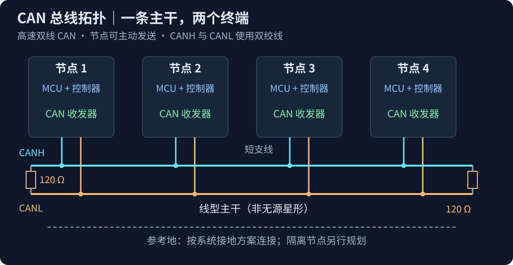

*图 3-1：推荐从“线型主干 + 短支线”理解高速 CAN。图中的参考地单独连接，终端电阻跨接 CANH 与 CANL。*

**接线顺序**：所有节点 CANH 接 CANH、CANL 接 CANL；非隔离节点还应规划参考地连接。终端只放在主干的两个物理端点，中间节点不再增加终端。若模块自带 120 Ω 电阻，应通过跳帽或焊盘确认其是否接入。

双绞线的差分特性阻抗通常选在约 120 Ω，终端用于吸收传输线反射。支线越长、节点电容越大，波形越容易出现反射和边沿变缓；无源星形或长支线不能仅凭“低速时能收发”就认为在全部工况下可靠。线长上限取决于线缆传播延迟、收发器延迟、位时序和时钟误差，不能只按波特率给出一个无条件有效的距离。[参考：TI CAN 物理层要求，第 4 节](https://www.ti.com/lit/an/slla270/slla270.pdf)

下面是**断电后、终端为普通电阻、没有其他并联路径时**的等效电阻计算，可用于初步排查：

| 接入终端 | CANH 与 CANL 间理论电阻 | 排查方向 |
| --- | --- | --- |
| 两个 120 Ω 并联 | 60 Ω | 终端数量可能正确，还需确认位置 |
| 只有一个 120 Ω | 120 Ω | 另一端终端缺失，或连接未接通 |
| 三个 120 Ω 并联 | 40 Ω | 中间模块可能误接了终端 |
| 没有终端 | 较高阻值，取决于器件与电路 | 检查终端与线缆连续性 |

测得约 60 Ω **不能证明接线和通信都正常**：两个终端都放在同一端，也可能测得同样结果。带分裂终端、电容或保护器件时，读数还可能有暂态变化。

#### 3.3 CAN 总线的电气属性 {#can-electrical}

##### 3.3.1 显性、隐性与差分电压

定义差分电压 $V_{diff}=V_{CANH}-V_{CANL}$，共模电压 $V_{CM}=(V_{CANH}+V_{CANL})/2$。高速 CAN 用 **显性（dominant，逻辑 0）** 和 **隐性（recessive，逻辑 1）** 表示位值。

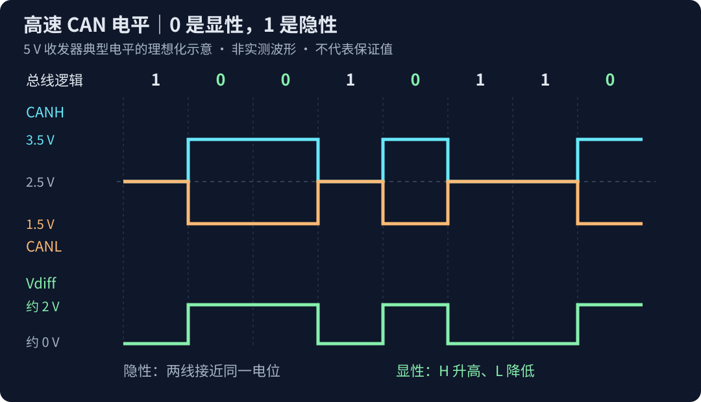

*图 3-2：5 V 收发器的典型、理想化示意；不是示波器实测，也不是所有器件的保证输出值。*

| 总线状态 | 逻辑值 | CANH 典型值 | CANL 典型值 | 差分典型值 | 正常模式下 RXD |
| --- | --- | --- | --- | --- | --- |
| 隐性 | 1 | 约 2.5 V | 约 2.5 V | 约 0 V | 高 |
| 显性 | 0 | 约 3.5 V | 约 1.5 V | 约 2 V | 低 |

这些电压用于建立直观认识。真正设计时要看器件的工作条件、输出保证值和接收门限，不能用“必须恰好 3.5 V / 1.5 V”判断好坏。[参考：TI CAN 入门，第 5 节](https://www.ti.com/lit/an/sloa101b/sloa101b.pdf)

以 TCAN1042HV 为例，在正常模式、数据手册规定的供电和温度条件下，当共模电压处于 −20～+20 V 范围，差分输入不低于 0.9 V 可保证判为显性，不高于 0.5 V 可保证判为隐性；两者之间不能假定有统一判定结果。**这不是总线故障耐压，也不是待机唤醒门限。**[参考：TCAN1042 系列数据手册，7.7 与表 9-5](https://www.ti.com/lit/ds/symlink/tcan1042h.pdf)

##### 3.3.2 为什么能“显性覆盖隐性”

发送隐性的节点释放差分驱动；只要有一个正常节点驱动显性，总线便呈现显性。它在逻辑上相当于“线与”：`1 AND 0 = 0`。因此多个节点在仲裁期间同时开始发送，并不会像两个普通推挽 GPIO 输出相反电平那样工作。

这里描述的是**专用 CAN 收发器的总线行为**，不要用普通 GPIO 模拟 CANH/CANL，也不要将不同节点的 TXD 引脚直接并联。

##### 3.3.3 抗干扰、参考地与测量

假设干扰同时给两根线叠加 +0.3 V，则显性时电平从 `3.5 / 1.5 V` 变成 `3.8 / 1.8 V`，差分仍为 2 V。这说明差分接收可以抑制一部分共模干扰，但共模电压仍必须在收发器的允许范围内。

**双线差分并不等于不需要考虑地。** 非隔离系统要给共模电流提供合理回路；节点间地电位差较大时，应评估隔离 CAN、隔离供电及总线侧参考地。屏蔽层、机壳地和信号参考地承担不同作用，应按系统 EMC 方案连接。[参考：TI CAN 物理层要求，4.3、4.4、4.9](https://www.ti.com/lit/an/slla270/slla270.pdf)

示波器测量优先看差分波形与采样点附近的稳定程度；用两通道相减时，两探头应匹配且地线都接合法参考地。普通接地示波器的地夹不要接在 CANL 上。万用表看到的是平均电压，不能据此判断位时序或振铃。

#### 3.4 经典 CAN 报文结构 {#can-frames}

##### 3.4.1 标准帧与扩展帧

经典 CAN 的数据域最多为 **8 字节**；标准格式使用 11 位标识符，扩展格式使用 29 位标识符。扩展帧扩大的是标识符空间，**不会把数据域扩大到 29 字节**。

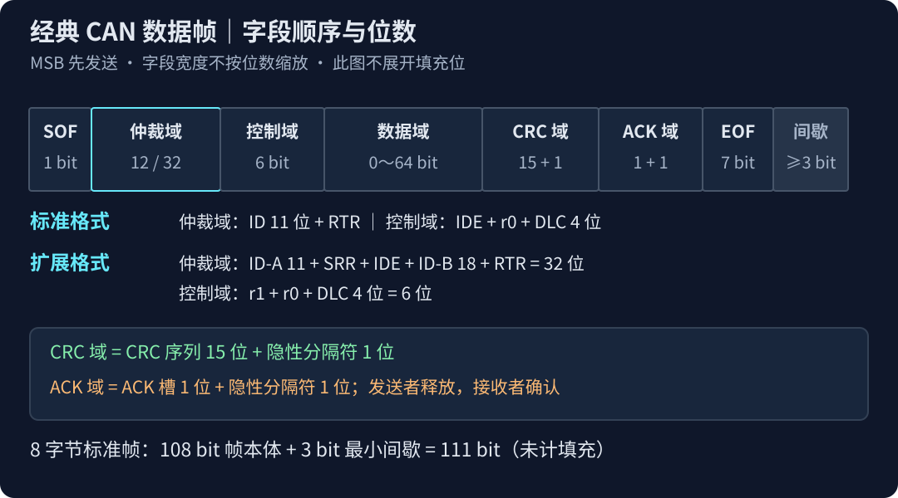

*图 3-3：按发送顺序绘制，宽度不与位数成比例；未展开动态填充位，Intermission 不属于帧本体。*

| 字段 | 标准数据帧长度 | 作用与取值 |
| --- | --- | --- |
| SOF | 1 bit | 显性 0，帧开始并建立同步 |
| 仲裁域 | 12 bit | 11 位 ID + RTR；数据帧 RTR=0 |
| 控制域 | 6 bit | IDE=0、保留位 r0、4 位 DLC |
| DATA | 0～64 bit | 0～8 字节应用数据 |
| CRC 域 | 16 bit | 15 位 CRC 序列 + 1 位隐性 CRC 分隔符 |
| ACK 域 | 2 bit | ACK 槽 + 1 位隐性 ACK 分隔符 |
| EOF | 7 bit | 连续隐性位，结束帧 |
| Intermission | 至少 3 bit | 相邻数据帧 / 远程帧之间的间歇，不计入帧本体 |

扩展数据帧的仲裁域为 `ID-A(11) + SRR(1) + IDE(1) + ID-B(18) + RTR(1)`，共 32 位；控制域为 `r1 + r0 + DLC(4)`。SRR 与 IDE 为隐性，标识符的高 11 位先发送。[参考：CiA 帧格式说明](https://www.can-cia.org/can-knowledge/can-cc)

以 8 字节标准数据帧为例，由上表求和得到：帧本体在未计填充位时为 **108 bit**，加最小间歇为 **111 bit**。在 500 kbit/s 下占用至少 `111 / 500000 = 222 μs`。扩展帧同条件为 `131 bit / 500000 = 262 μs`。这只是估算下界，填充位、错误重发和排队会增加实际时间。

##### 3.4.2 四种帧与 ACK 的含义

| 类型 | 用途 | 学习时需要注意 |
| --- | --- | --- |
| 数据帧 | 携带实际数据 | 日常收发的主要对象 |
| 远程帧 | 请求某 ID 的数据，RTR=1 | 没有 DATA 域，DLC 表示请求长度；不要假设设备会自动应答 |
| 错误帧 | 通知总线发生链路错误 | 与应用自己定义的“故障状态报文”不同 |
| 过载帧 | 在协议允许条件下延后后续传输 | 不是应用层通用流控，不应作为正常调度办法 |

ACK 槽中，发送者发隐性，正确接收该帧且处于正常参与通信模式的接收者发显性。ACK 不携带接收者地址；它只说明有节点在链路层正确接收，**不能证明指定设备已执行命令**。接收过滤通常决定报文是否进入应用接收队列，而不是决定是否给正确帧 ACK。仅监听模式不参与 ACK。

因此测试至少需要另一个能够正常 ACK 的节点。只有发送板加一个“静默监听”分析仪，仍可能不断出现 ACK 错误。需要“执行完成”的确认时，应在应用协议里设计响应 ID、序号和超时。[参考：Microchip CAN 错误机制](https://developerhelp.microchip.com/xwiki/bin/view/applications/can/overview/errors/)

#### 3.5 仲裁与优先级：多个节点如何同时发送 {#can-arbitration}

节点先等待总线允许发送，再从 SOF 开始边发送边读取总线。**在仲裁位上，发 1 却读到 0 的节点退出发送，转为接收；获胜节点的帧继续完成。** 这称为无损逐位仲裁，不是出错后丢掉整个报文再碰运气重发。[参考：CiA 仲裁说明](https://www.can-cia.org/can-knowledge/can-cc)

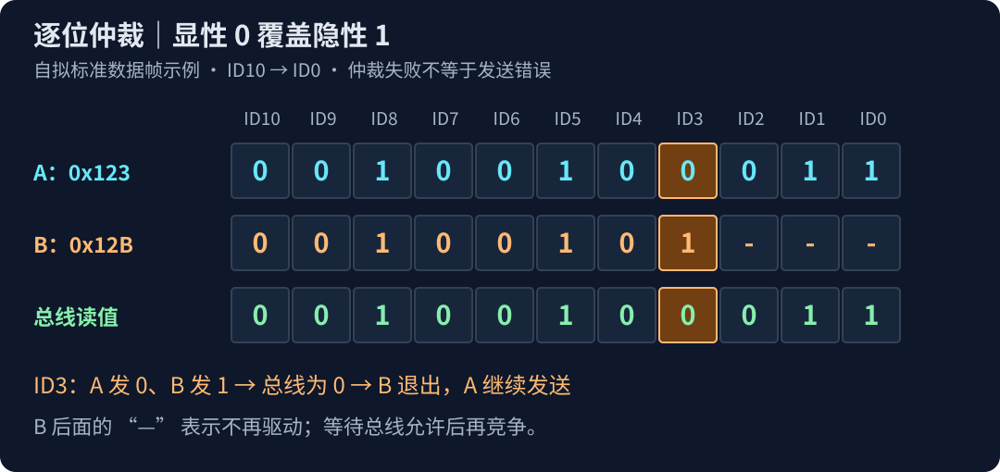

*图 3-4：自拟例子，只展开标识符位，不绘制 SOF 与填充位。*

假设 A、B 同时发送标准数据帧：

```text
A 的 ID = 0x123 = 00100100011
B 的 ID = 0x12B = 00100101011
差异位 ID3：A 发 0，B 发 1
```

从最高位 ID10 开始，前七位相同；在 ID3，A 驱动显性，B 检测到总线为 0，于是退出。A 发送结束后，B 才重新竞争。B 的仲裁失败不应当作物理层错误处理。

**比较优先级的边界**：同一种格式的数据帧中，数值更小的 ID 优先；相同 ID 的经典数据帧优先于远程帧；标准格式与扩展格式的高 11 位相同时，标准格式优先。不能直接把任意 11 位 ID 和任意 29 位 ID 当成同宽整数比较。

协议规划时，给紧急消息较高优先级，同时限制发送周期。低 ID 不会打断已经开始传输的帧；若高优先级报文持续占满总线，低优先级报文仍可能长时间等待。也应避免两个节点同时用相同 ID 发送不同数据：它们可能一起通过仲裁，却在数据域发生位错误。为每类周期消息明确唯一发布者，是一个容易维护的设计办法。

#### 3.6 位填充、CRC 与错误处理 {#can-errors}

##### 3.6.1 位填充为什么存在

CAN 没有独立时钟线，接收方利用边沿调整采样时刻。经典 CAN 从 SOF 到 CRC 序列结束的填充区域内，若连续出现五个同值位，发送器插入一个相反位，接收器再移除。CRC 分隔符、ACK 与 EOF 不采用这套动态填充规则。[参考：Microchip CAN 错误机制](https://developerhelp.microchip.com/xwiki/bin/view/applications/can/overview/errors/)

```text
原始片段：0 0 0 0 0     0 0 0
总线片段：0 0 0 0 0 [1] 0 0 0
                    ↑ 控制器自动插入，接收后删除
```

所以分析仪解码出来的字节数不包含填充位，实际线上位数却会变化。应用程序只提交 ID、长度和数据，不应自己把填充位塞进数据数组。

##### 3.6.2 常见错误类型

| 错误 | 检测对象 | 排查思路 |
| --- | --- | --- |
| Bit Error | 发送与读回不一致，协议规定的仲裁 / ACK 例外除外 | 收发器模式、短路、干扰、同 ID 多发布者 |
| Stuff Error | 填充区域内位序列不符合规则 | 位时序、信号完整性、波特率 |
| CRC Error | 接收计算值与收到的 CRC 不一致 | 数据途中被破坏、采样不稳 |
| Form Error | 固定格式字段出现非法位值 | 速率配置、帧格式兼容性、信号完整性 |
| ACK Error | 发送者在 ACK 槽没有读到显性 | 没有正常接收节点、接收端只监听、接线或速率错误 |

这些是排查方向，不是一一对应的故障诊断。控制器通常会按配置自动重发；单次发送、禁止自动重传等选项会改变表现。[参考：Kvaser CAN 错误处理](https://kvaser.com/lesson/can-error-handling/)

##### 3.6.3 错误主动、错误被动与 Bus-off

控制器维护发送错误计数器 **TEC** 和接收错误计数器 **REC**。它们用于隔离故障节点，不是“失败报文数”的简单累加。

| 状态 | 判定要点 | 行为 |
| --- | --- | --- |
| Error Active | TEC、REC 都小于 128 | 可正常通信，出错时可以发送主动错误标志 |
| Error Passive | TEC 或 REC 达到 128，且未进入 Bus-off | 仍可通信，但错误标志为被动，并有额外发送约束 |
| Bus-off | TEC 超过 255 | 停止参与正常总线通信，等待恢复流程 |

主动错误标志为 6 个显性位，被动错误标志为 6 个隐性位；错误分隔符为 8 个隐性位。多个节点的主动错误标志可能叠加，因此示波器上看到的显性区段不一定只有 6 bit。具体计数增减有例外，不能把每次错误都按固定数值累计；例如缺 ACK 与错误被动状态有关的例外，会影响单节点测试现象。[参考：Kvaser 错误限制机制](https://kvaser.com/lesson/can-error-handling/)

经典 CAN 的 Bus-off 恢复涉及检测 **128 次、每次 11 个连续隐性位**，还要满足控制器规定的软件恢复条件。实际产品应记录出错原因，限制恢复频率，并处理丢失的应用数据，不宜只在中断里无限复位外设。[参考：Bosch M_CAN 手册，协议状态寄存器与 Bus-off 恢复](https://www.bosch-semiconductors.com/media/ip_modules/pdf_2/m_can/mcan_users_manual_v331.pdf)

#### 3.7 位时序、采样点与速率计算 {#can-bit-timing}

一个 CAN 位由同步段 SYNC_SEG、传播段 PROP_SEG、相位缓冲段 PHASE_SEG1 和 PHASE_SEG2 构成，长度以时间量子 **TQ** 计。许多控制器把 `PROP_SEG + PHASE_SEG1` 合并为 TSEG1 / BS1，把 PHASE_SEG2 称为 TSEG2 / BS2。

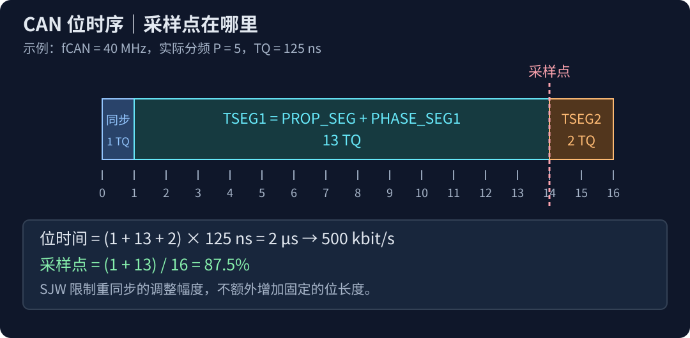

*图 3-5：40 MHz 控制器时钟、实际分频系数 5 的自拟例子，得到 500 kbit/s 和 87.5% 采样点。*

令 $P$ 为**实际分频系数**，而不是寄存器原始编码，则：

$
t_{TQ}=\frac{P}{f_{CAN}},\qquad
R_{bit}=\frac{f_{CAN}}{P(1+TSEG1+TSEG2)}
$

$
SP=\frac{1+TSEG1}{1+TSEG1+TSEG2}\times100\%
$

采样点位于 TSEG1 末端。SOF 用于硬同步，帧内符合条件的边沿用于重同步；**SJW** 限制一次重同步所允许的相位调整量，并不是每个数据位额外附加的时间。[参考：Microchip 位时序配置](https://onlinedocs.microchip.com/oxy/GUID-4D282FC5-82FC-4934-8BAD-D4A5D8422E6C-en-US-7/GUID-8FAD80F3-8BD3-4A27-A2EB-736FC7248AD4.html)

| 参数 | 示例值 | 计算 / 说明 |
| --- | --- | --- |
| CAN 内核时钟 | 40 MHz | 确认外设真正得到的时钟，不是直接套 CPU 主频 |
| 实际分频系数 P | 5 | TQ = 5 / 40 MHz = 125 ns |
| SYNC_SEG | 1 TQ | 固定同步段 |
| TSEG1 | 13 TQ | 传播段与第一相位段之和 |
| TSEG2 | 2 TQ | 采样后的相位段 |
| 总位长 | 16 TQ | 16 × 125 ns = 2 μs |
| 位速率 | 500 kbit/s | 1 / 2 μs |
| 采样点 | 87.5% | (1 + 13) / 16 |
| SJW | 示例选 2 TQ | 还须满足具体控制器的段长度约束 |

不同 MCU 可能用“值减一”编码，也可能在时钟路径上再乘除固定系数。应先算实际时间，再根据参考手册填寄存器或驱动 API。相同波特率不等于所有时序都兼容：还要检查采样点、传播延迟预算、时钟精度和 SJW；87.5% 只是本例结果，并非所有网络的必选值。

#### 3.8 CAN FD：与经典 CAN 的区别 {#can-fd}

CAN FD（Flexible Data-rate）保留仲裁机制，扩大数据域，并允许一帧内切换位速率。**仲裁阶段仍使用公用的标称速率**；启用 BRS 时，在 BRS 的采样点切换至数据阶段速率，并在 CRC 分隔符的采样点切回。[参考：CiA CAN FD](https://www.can-cia.org/can-knowledge/can-fd-the-basic-idea)

| 项目 | 经典 CAN | CAN FD |
| --- | --- | --- |
| 标识符 | 11 / 29 位 | 11 / 29 位 |
| 单帧数据 | 0～8 字节 | 最多 64 字节 |
| 速率 | 整帧使用同一速率，最高 1 Mbit/s | 可保持单速率，也可通过 BRS 切换；上限取决于控制器、收发器和网络 |
| 远程帧 | 支持 RTR 远程请求 | 不支持 FD 远程帧 |
| CRC 序列 | 15 位 | 不超过 16 字节时 17 位；更长时 21 位 |
| 新控制位 | 无 FDF / BRS / ESI | FDF 标识 FD；BRS 控制变速；ESI 表示发送节点错误状态 |

ESI=0 表示错误主动，ESI=1 表示错误被动。ISO CAN FD 的 CRC 区域还包含额外保护和固定填充规则，不能直接套用经典 CAN 的全部填充规则。[参考：Microchip CAN FD 概述](https://developerhelp.microchip.com/xwiki/bin/view/applications/can/overview/canfd/)

CAN FD 的 DLC 并非总等于字节数：

| DLC | 0～8 | 9 | 10 | 11 | 12 | 13 | 14 | 15 |
| --- | --- | --- | --- | --- | --- | --- | --- | --- |
| 数据字节数 | 与 DLC 相同 | 12 | 16 | 20 | 24 | 32 | 48 | 64 |

例如要发送 10 字节应用数据，可以按双方约定补齐为 12 字节，并使用 DLC=9。协议里应说明有效长度和补齐规则。[参考：Bosch M_CAN 手册，表 54](https://www.bosch-semiconductors.com/media/ip_modules/pdf_2/m_can/mcan_users_manual_v331.pdf)

FD 控制器通常能够收发经典帧，但经典控制器不能因此自动识别 FD 帧；混合网络发送 FD 前，应确认所有参与节点支持或具有合适的容忍 / 隔离策略。另需核对 ISO / 非 ISO FD 模式，以及收发器在目标数据速率下的时序保证。下面的硬件示例用于经典 500 kbit/s 学习，不应仅改软件速率就当成已经验证的高速 FD 方案。

#### 3.9 硬件电路与 PCB 设计 {#can-hardware}

##### 3.9.1 3.3 V MCU + 5 V 收发器的连接示例

下图使用 **TCAN1042HV、SOIC-8 封装**作为教学例子：VCC 为 5 V，带 VIO 的版本将逻辑接口接到 MCU 的 3.3 V 电源。注意选型后缀，无 VIO 版本不能简单按同一引脚功能替换。

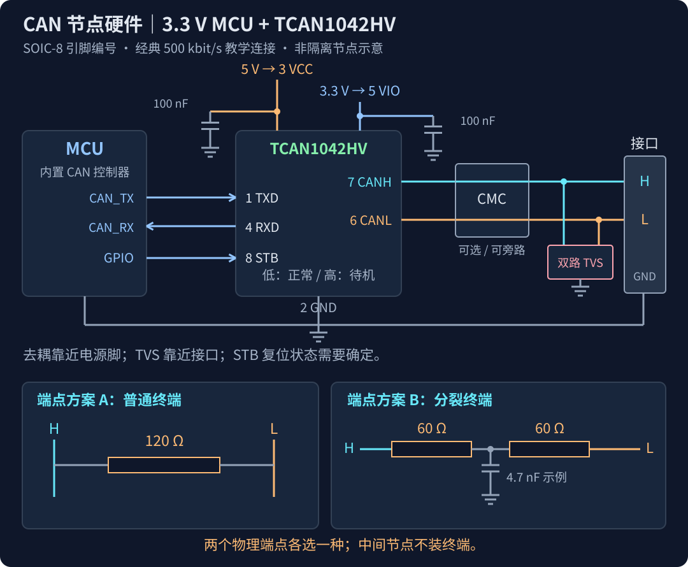

*图 3-6：连接关系示意，不是已完成 EMC、浪涌和温升验证的生产原理图；TVS 与可选共模扼流圈需要按系统条件选型。*

| 引脚 | 名称 | 本例连接 |
| --- | --- | --- |
| 1 | TXD | MCU CAN_TX |
| 2 | GND | 本节点信号参考地 |
| 3 | VCC | 5 V，近引脚放置 100 nF 去耦 |
| 4 | RXD | MCU CAN_RX |
| 5 | VIO | 3.3 V，近引脚放置 100 nF 去耦 |
| 6 | CANL | 总线 CANL，经所需保护网络连接到接口 |
| 7 | CANH | 总线 CANH，经所需保护网络连接到接口 |
| 8 | STB | MCU GPIO 控制；低为正常，高为待机；复位时保证确定电平 |

VIO 只是逻辑接口电源，不能替代 VCC。上电调试时，先确认两路电源、TXD 空闲电平和 STB 状态，再检查总线波形。器件供电范围、保护等级及具体模式行为以数据手册为准。[参考：TI 数据手册，第 6、9、10、11 节](https://www.ti.com/lit/ds/symlink/tcan1042h.pdf)

##### 3.9.2 普通终端与分裂终端

普通终端是在 CANH 与 CANL 之间跨接一个约 120 Ω 电阻。分裂终端用两个约 60 Ω 电阻串联，中点通过电容接参考地；直流差分终端仍约为 120 Ω，中点电容用于改善共模高频表现。图中 **4.7 nF 是示例值**，需结合 EMC 和节点参考地方案验证。两种方式在同一个端点是替代关系，不应同时重复接入。[参考：TI CAN 物理层要求，4.5](https://www.ti.com/lit/an/slla270/slla270.pdf)

以理想显性差分电压 2 V 估算，单个 120 Ω 终端耗散为 $P=V^2/R\approx33\,mW$。选额定功率时还要考虑真实电压、持续显性、环境温度和故障工况，不能只照这个典型值选最小封装。

##### 3.9.3 保护器件与布局检查

| 部位 | 设计目的 | 检查点 |
| --- | --- | --- |
| 去耦电容 | 减小电源瞬态与供电回路电感 | 靠近电源脚，回地路径短 |
| TVS / ESD 保护 | 限制接口瞬态电压 | 反向工作电压、钳位电压、结电容与收发器能力匹配；靠近接口 |
| 共模扼流圈（可选） | 改善共模传导 / 辐射表现 | 差分寄生参数不能明显破坏边沿；是否安装由实测决定 |
| 终端跳帽 / 焊盘 | 适应节点处于端点或中间的不同安装方式 | 丝印清楚，避免每块板默认都接入 |
| CANH / CANL 走线 | 维持对称、连续的信号路径 | 两线相邻、减少不对称过孔，远离开关电源高 dv/dt 节点 |
| 隔离方案 | 限制跨节点地电位差与回路问题 | 数字信号与供电都要处理；不得用地线跨接破坏隔离边界 |

这是从功能出发的设计检查表，不是一套通用器件清单。特别是 TVS 的钳位能力和附加电容需要一起权衡；CAN 专用保护器件的参数也不能仅凭“适用于 CAN”标签就省略核对。

#### 3.10 从接通到读懂报文：实验与排错 {#can-practice}

##### 3.10.1 两节点入门实验

1. 准备两块带 CAN 控制器与收发器的板，或一块板加正常通信模式的 USB-CAN 接口。先用短双绞线连接 CANH、CANL 与合适的参考地。
2. 断电检查两个端点的终端、极性和连接连续性，再上电测量 VCC、VIO 与模式引脚。
3. 两端先使用经典 CAN、500 kbit/s，配置匹配的位时序；先放宽接收过滤，确认能观察报文。
4. A 每 100 ms 发送一帧固定 ID 的数据，B 记录 ID、DLC、数据和时间戳，检查 ACK、错误计数器与丢帧。
5. 在基本通信稳定后，再加入过滤、应用响应、超时、不同优先级以及断线恢复实验；不要一开始同时调长线、高速、隔离和 FD。

##### 3.10.2 自定义 8 字节消息示例

下面是**本节自拟学习协议**，不是 CANopen、J1939 或任何车辆的报文定义。约定 ID=`0x321`、标准数据帧、DLC=8、周期 100 ms：

| 字节 | 含义 | 编码约定 | 示例值 |
| --- | --- | --- | --- |
| 0～1 | 转速 | uint16，小端，1 rpm / LSB | `E8 03` → 0x03E8 → 1000 rpm |
| 2～3 | 温度 | int16，小端，0.01 ℃ / LSB | `C4 09` → 2500 → 25.00 ℃ |
| 4 | 状态标志 | bit0=使能，bit2=就绪，其余本例保留 | `05` → 两项置位 |
| 5 | 消息序号 | uint8，每次发送加一并回绕 | `2A` → 42 |
| 6～7 | 保留 | 本例固定为 0 | `00 00` |

```text
ID: 0x321   格式: 标准数据帧   DLC: 8
DATA: E8 03 C4 09 05 2A 00 00
```

CAN 负责可靠地传输这些位，但不会自动说明温度单位、符号、缩放系数、有效期或字节序。**应用字段的小端编码**与“报文字段按位发送的顺序”是两个层面，解码时不能混淆。应用层还应规定多久没有新消息就判为失联、序号跳变怎样处理、保留位如何兼容未来版本。

##### 3.10.3 故障排查表

| 现象 | 优先检查 |
| --- | --- |
| MCU 有 TX 活动，总线没有差分变化 | TXD 是否正确连接、VCC 是否供电、STB 是否仍在待机 |
| 能看到发帧，但不断重发 | 是否缺 ACK；接收端是否为只监听；两端速率和格式是否一致 |
| 短线正常，长线或高负载时出错 | 两端终端位置、长支线、地电位差、振铃、传播延迟与采样点 |
| 分析仪正常，应用收不到数据 | 标准 / 扩展 ID 过滤、FIFO、接收中断、软件队列和溢出标志 |
| 偶发错误逐渐变为 Bus-off | 记录 TEC / REC、最后错误类型和电源变化，再定位线路或配置 |
| 经典帧正常，FD 帧失败 | FD 能力与模式、BRS、数据阶段时序、收发器速率、延迟补偿 |
| 报文收到了，但数值明显不对 | 字节序、符号、缩放、位偏移、协议版本与有效长度 |

初次学习可以按 **“终端和接线 → 电平 → 帧结构 → ACK → 仲裁 → 时序 → 错误恢复 → 应用数据”** 的顺序验证。每次只改变一个条件，并同时保存分析仪日志、错误计数和波形，比较容易区分物理层问题与应用编码问题。

#### 3.11 延伸阅读 {#can-references}

本节图 3-1～3-6 均为针对学习内容重新绘制的示意图；电平图不是实测记录，示例参数不代表已经验证的产品设计。继续查阅时可按下表定位：

| 资料 | 推荐阅读内容 |
| --- | --- |
| [TI：Introduction to CAN（SLOA101B）](https://www.ti.com/lit/an/sloa101b/sloa101b.pdf) | 控制器 / 收发器分工与物理信号入门 |
| [TI：CAN Physical Layer Requirements（SLLA270）](https://www.ti.com/lit/an/slla270/slla270.pdf) | 布线、终端、参考地、延迟预算 |
| [CiA：CAN CC](https://www.can-cia.org/can-knowledge/can-cc) | 经典 CAN 的帧格式和仲裁 |
| [Microchip：CAN Bus Errors](https://developerhelp.microchip.com/xwiki/bin/view/applications/can/overview/errors/) | 填充、校验及 ACK 错误 |
| [Kvaser：CAN Error Handling](https://kvaser.com/lesson/can-error-handling/) | 错误计数、被动状态与 Bus-off |
| [Microchip：Bit Timing Configuration](https://onlinedocs.microchip.com/oxy/GUID-4D282FC5-82FC-4934-8BAD-D4A5D8422E6C-en-US-7/GUID-8FAD80F3-8BD3-4A27-A2EB-736FC7248AD4.html) | TQ、采样点和重同步 |
| [CiA：CAN FD](https://www.can-cia.org/can-knowledge/can-fd-the-basic-idea) / [Microchip：CAN FD](https://developerhelp.microchip.com/xwiki/bin/view/applications/can/overview/canfd/) | FD 的新增字段和数据阶段 |
| [Bosch：M_CAN 用户手册](https://www.bosch-semiconductors.com/media/ip_modules/pdf_2/m_can/mcan_users_manual_v331.pdf) | 控制器行为、FD DLC、恢复流程 |
| [TI：TCAN1042 系列数据手册](https://www.ti.com/lit/ds/symlink/tcan1042h.pdf) | 本节器件引脚、电气条件、典型应用 |

## 二、通信标准

### 1.RS-485串行通信标准与电路

#### 1.1 理论基础

**RS485** 是美国电子工业协会（Electronic Industries Association，EIA）于1983年发布的串行通信接口标准，经通讯工业协会（TIA）修订后命名为 **TIA/EIA-485-A**。
RS485 是一种工业控制环境中常用的通讯协议，其中**RS** 是 **Recommended Standard** 的缩写。
RS485 是 **半双工异步** 串行通信。

##### 1.1.1 特点

- 支持多节点：一般最大支持 32 个节点。
- 传输距离远：最远通讯距离可达1200米。
- 抗干扰能力强：差分信号传输。
- 连接简单：只需要两根信号线（A+和B-）就可以进行正常的通信。

##### 1.1.2 差分信号传输

**RS485 通信**采用差分信号传输，通常情况下只需要两根信号线就可以进行正常的通信。
在差分信号中，**逻辑0**和**逻辑1**是用两根信号线（A+和B-）的**电压差**来表示。

**逻辑 1**：两根信号线（A+和B-）的电压差在<mark>+2V～+6V</mark>之间。
**逻辑 0**：两根信号线（A+和B-）的电压差在<mark>2V～-6V</mark> 之间。

##### 1.1.3 连接方式

在 RS485 通信网络中，通常会使用 485 收发器来转换 **TTL 电平**和 **RS485 电平**。
节点中的串口控制器使用 RX 与 TX 信号线连接到 485 收发器上，而收发器通过差分线连接到网络总线。
串口控制器与收发器之间一般使用 TTL 信号传输，收发器与总线则使用差分信号来传输。
**发送数据时**，串口控制器的 TX 信号经过收发器转换成差分信号传输到总线上。
**接收数据时**，收发器把总线上的差分信号转化成 TTL 信号通过 RX 引脚传输到串口控制器中。
通常在这些节点中只能有一个主机，剩下的全为从机。
在总线的起止端分别加了一个 120 欧的匹配电阻。

具体连接图如下所示：
 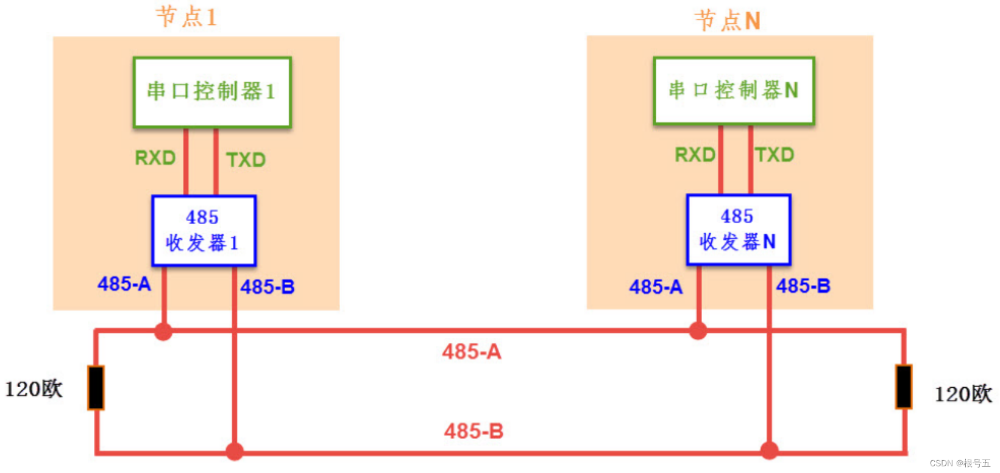 


#### 1.2 常见 RS-485 硬件电路

**SP3485** 芯片是一款非常经典的+3.3V低功耗半双工RS485收发器，数据传输速率高达**10Mbps。**
单片机串口通信一般是**TTL电平**，如果需要**RS485 通信**，就需要**RS485芯片**在中间转换一下。
因为RS485通信是**半双工通信**，就是**发送数据的时候不能同时接收数据**，所以我们选择SP3485做RS485收发器。

##### 1.2.1 SP3485 芯片引脚

SP3485 芯片的引脚图如下所示：

 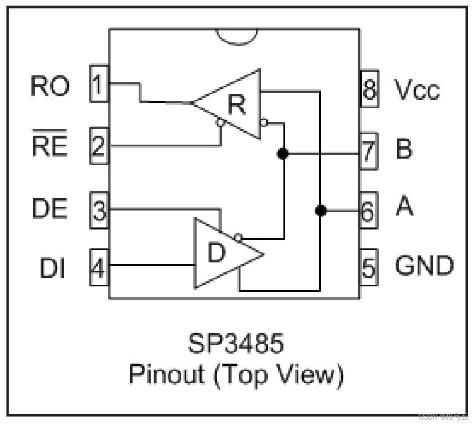 

 引脚说明如下： 

| 引脚 | 名称 |               功能                |
| :--: | :--: | :-------------------------------: |
|  1   |  RO  |        接收器输出----接RX         |
|  2   |  RE  | 接收器输出使能（低电平-接收使能） |
|  3   |  DE  | 驱动器输出使能（高电平-发送使能） |
|  4   |  DI  |        驱动器输入----接TX         |
|  5   | GND  |               接地                |
|  6   |  A   |   驱动器输出/接收器输入（同相）   |
|  7   |  B   |   驱动器输出/接收器输入（反相）   |
|  8   | VCC  |           芯片供电+3.3V           |

##### 1.2.2 RS485 电路图----普通收发

RS485 电路图如下图所示：

 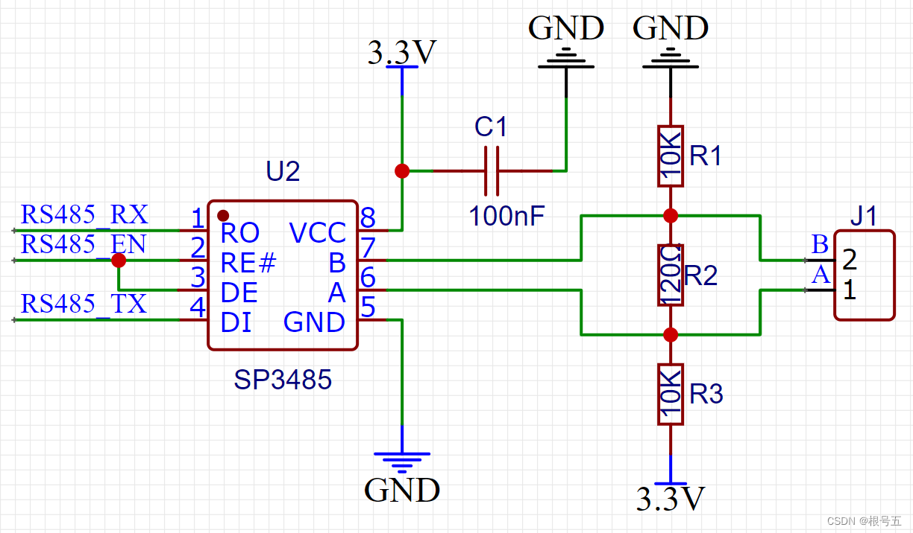 

RS485 普通收发电路图原理：

- **RS485_EN 为高电平**，逻辑为1，发送使能，接收禁止。
- **RS485_EN 为低电平**，逻辑为0，发送禁止，接收使能

在编写驱动程序时：

- 在**发送数据前**，给RS485_EN 置高电平。
- 在**发送数据后**，给RS485_EN 置低电平。

##### 1.2.3 RS485 电路图----自动收发

RS485 电路图如下图所示：

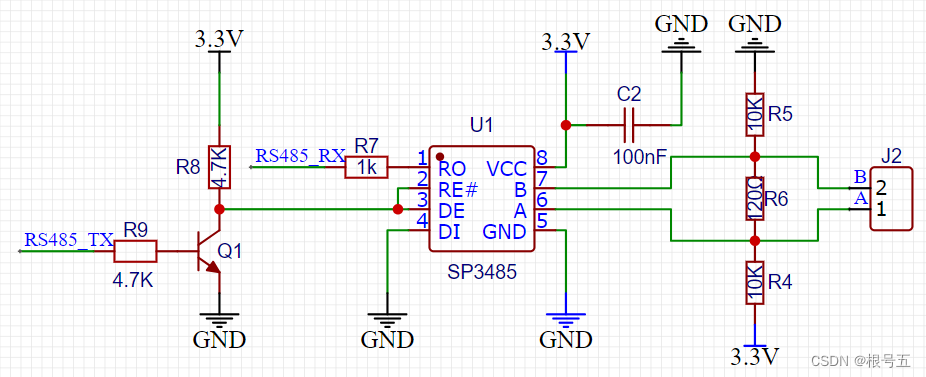 

RS485 自动收发电路比RS485 普通收发电路增加了一个**三极管开关电路**，是由**电阻R8**、**电阻R9** 和 **NPN三极管Q1** 组成。
**R9是限流电阻**：最好选择4.7K，也可以选择10K。
**R8是上拉电阻**：可以选择4.7K或者10K。
**NPN三极管Q1**：高电平导通，低电平截止。

**接收数据**
接收数据引脚是 **RS485_RX**，在接收数据过程中，RS485_TX引脚一直保持高电平，NPN三极管Q1导通，RE和DE的引脚是低电平，发送禁止，接收使能，进入接收状态。

**发送数据**
发送数据引脚是 **RS485_TX**，应该 RS485_TX 发送1，AB发送1；RS485_TX 发送0，AB发送0。

- **当 RS485_TX 发送1时**：NPN三极管导通，RE和DE的引脚是低电平，发送禁止，接收使能，进入接收状态，SP3485芯片的AB引脚进入高阻状态，因为R4把A拉高，R5把B拉低，所以，AB传输的是1。所以，当RS485_TX发送1时，AB引脚发送1。
- **当 RS485_TX 发送0时**：NPN三极管不导通，RE和DE的引脚是高电平，进入发送状态，SP3485芯片会把DI上的电平反应到AB引脚上输出，因为DI已经接地，所以AB引脚会传输0。所以，当RS485_TX发送0时，AB引脚发送0。
